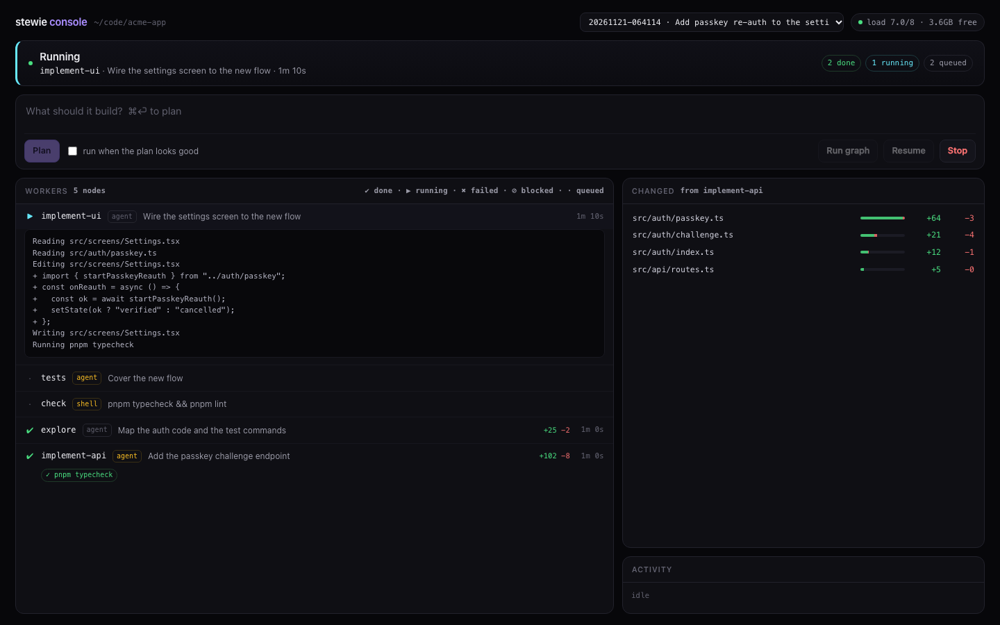

# stewie

A dashboard for coding agents, running on a 15-year-old LG TV in my office.



I use Claude Code, Codex, Grok and OpenCode every day. They all do the same thing badly:
they run in a terminal scrollback, one job at a time, and a long job dies with the window.
So I built the piece I kept wanting: a small runner that takes a goal, splits it into
workers, runs a couple at a time, checks its own work, and survives a crash. Then I put a
big screen on it so I can see what the agents are doing from across the room.

That screen is an old LG TV with a browser pointed at `localhost`. It never needed to be
more than that.


## What it actually does

- **Plans before it edits.** A read-only planner agent reads the repo and writes a dependency graph of small tasks.
- **Runs workers in parallel, with a ceiling.** Two at a time by default, one heavy job (tests, typecheck, build) at a time.
- **Refuses to melt the machine.** Before every start it reads real free RAM and load average. If either is over the line it holds and resumes when the machine frees up.
- **Checks its own work.** Every node can carry a verify command. The node is done when that command passes, not when the model says it is.
- **Survives a crash.** Node state is written to disk on every transition, so `stewie resume` picks up where it stopped.
- **Shows you the work.** Live log of the worker that is running, the files it touched with line counts, and a pass or fail for each check.

## Install

```bash
git clone https://github.com/ryanramtin/stewie.git
cd stewie
npm link          # puts `stewie` on your PATH
node --test "test/*.test.mjs"
```

Node 20 or newer. Agent nodes call `opencode run`; shell-only graphs work without it.

## Use

From any repo:

```bash
stewie plan "add a --verbose flag to the web server and cover it with a test"
stewie run
stewie status
```

Or open the console and do it from there:

```bash
stewie serve            # http://127.0.0.1:4321
stewie serve --tv       # big type, no input box, for a wall screen
stewie serve --lan      # reachable from other devices; prints a token URL
```

`stewie --help` lists the rest: `resume`, `logs`, `graph`, `verify`, `doctor`, `init`.

## The graph

A graph is a JSON file. Everything else is optional.

```json
{
  "goal": "Add passkey re-auth to the settings screen",
  "nodes": [
    { "id": "explore", "task": "Map the auth code and list the test commands." },
    { "id": "api", "deps": ["explore"], "task": "Add the challenge endpoint.", "verify": ["pnpm typecheck"] },
    { "id": "check", "deps": ["api"], "kind": "shell", "command": "pnpm test -- passkey" }
  ]
}
```

Agent nodes get a child session with the goal, their task, and a summary of every node that
finished before them. Shell nodes run in `zsh -lc`. A node's verify commands decide success,
and a failure retries once with backoff before it fails the node and blocks whatever
depended on it.

## Why a graph instead of one long session

One long session has no place to checkpoint, no way to parallelise, and no gate between
"the model thinks it is done" and "it is done". A graph gives you all three, and it makes
the work visible, which is the whole point of the TV.

## Safety

- Workers run with `nice -n 10`, in their own process group, with a timeout that kills the group.
- State is written atomically, so a hard kill cannot corrupt a run.
- Node prompts forbid commits, pushes and deploys.
- `stewie serve` binds to loopback unless you pass `--lan`, which mints a random token: the browser gets a cookie, every API call needs it, and the TV URL it prints already carries it.

## Also in here

- `stewie verify` runs the repo's typecheck, lint and test in one go.
- `scripts/build-app.sh` builds a macOS launcher for the console. `scripts/make-icon.mjs` draws its icon with no dependencies.
- `scripts/demo.mjs` seeds a fake run so you can look at the dashboard without spending tokens.

## License

MIT.
