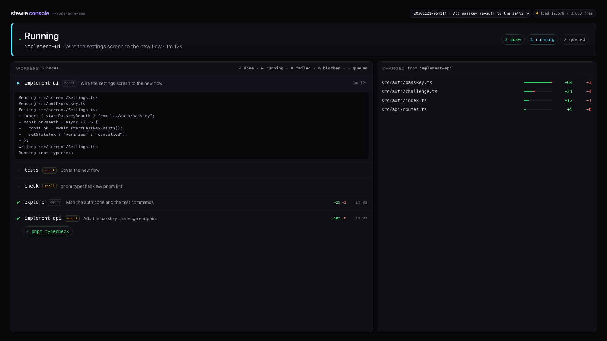

# stewie

A dashboard for coding agents, running on a 15-year-old LG TV in my office.


I use Claude Code, Codex, Grok and OpenCode every day. They all do the same thing badly:
they run in a terminal scrollback, one job at a time, and a long job dies with the window.
So I built the piece I kept wanting: a small runner that takes a goal, splits it into
workers, runs a couple at a time, checks its own work, and survives a crash. Then I put a
big screen on it so I can see what the agents are doing from across the room.

That screen is an old LG TV with a browser pointed at `localhost`. It never needed to be
more than that.



## What it actually does

- **Plans before it edits.** A read-only planner agent reads the repo and writes a dependency graph of small tasks.
- **Runs workers in parallel, with a ceiling.** Two at a time by default, one heavy job (tests, typecheck, build) at a time.
- **Refuses to melt the machine.** Before every start it reads real free RAM and load average. If either is over the line it holds and resumes when the machine frees up — a long wait does not quietly start a node anyway; `--force-start` is the deliberate override.
- **Checks its own work.** Every node can carry a verify command. The node is done when that command passes, not when the model says it is.
- **Remembers the last run.** What each node changed, checked and failed at goes into `.stewie/memory`, and the next run's prompts start with it instead of from zero.
- **Survives a crash.** Node state is written to disk on every transition, so `stewie resume` picks up where it stopped.
- **Shows you the work.** Live log of the worker that is running, the files it touched with line counts, and a pass or fail for each check.

## Install

```bash
git clone https://github.com/ryanramtin/stewie.git
cd stewie
npm link          # puts `stewie` on your PATH
node --test "test/*.test.mjs"
```

Node 20 or newer. Agent nodes call `opencode run`; shell-only graphs work without it.

## Use

From any repo:

```bash
stewie plan "add a --verbose flag to the web server and cover it with a test"
stewie run
stewie status
```

Or open the console and do it from there:

```bash
stewie serve            # http://127.0.0.1:4321
stewie serve --tv       # big type, no input box, for a wall screen
stewie serve --tv --view calendar   # wall screen that opens on the week
stewie serve --tv --idle 60         # quiet for 60s and the week takes over
stewie serve --lan      # reachable from other devices; prints a token URL
```

`stewie --help` lists the rest: `resume`, `logs`, `undo`, `graph`, `verify`, `doctor`, `init`.

## The graph

A graph is a JSON file. Everything else is optional.

```json
{
  "goal": "Add passkey re-auth to the settings screen",
  "nodes": [
    { "id": "explore", "task": "Map the auth code and list the test commands." },
    { "id": "api", "deps": ["explore"], "task": "Add the challenge endpoint.", "verify": ["pnpm typecheck"] },
    { "id": "check", "deps": ["api"], "kind": "shell", "command": "pnpm test -- passkey" }
  ]
}
```

Agent nodes get a child session with the goal, their task, and a summary of every node that
finished before them. Shell nodes run in `zsh -lc`. A node's verify commands decide success,
and a failure retries once with backoff before it fails the node and blocks whatever
depended on it.

## Engines

A node runs on whichever agent CLI you already have: **opencode** (default), **codex**,
**claude** or **grok**. `"engine": "codex"` on a node, or on the graph for every node, picks
it. `engineArgs` passes flags the table does not know yet, and `STEWIE_OPENCODE_BIN`,
`STEWIE_CODEX_BIN`, `STEWIE_CLAUDE_BIN`, `STEWIE_GROK_BIN` override where a binary lives.
Each engine runs unattended (opencode `--auto`, codex `--approve-for-me`, claude
`--dangerously-skip-permissions`, grok `--always-approve`), because a node has nobody at the
keyboard — the RAM/load guard, the verify gate and the inbox ask gates are the safety
boundary, not the CLI's prompts.

```json
{ "id": "review", "engine": "claude", "model": "sonnet", "task": "Review the diff.", "verify": ["pnpm typecheck"] }
```

Model names are the engine's own, and `agent` keeps its opencode meaning (or claude/grok
`--agent`). Shell nodes are unchanged and still run through `zsh -lc`.

## The weekly ceiling

A run already stops on `--budget-min` and `--max-nodes`. The ceiling is the week-wide
version, on disk, so three runs in one night cannot add up to something you did not agree to.

```bash
stewie budget set nodes=60 minutes=600 money=10
stewie budget                    # what is left this week
```

Limits live in `.stewie/budget.json` and reset Monday. Nodes and minutes are measured; money
counts only what a graph declares with `"cost"` on a node (USD, per run), so a graph running on
a subscription simply declares nothing and the money cap stays idle. A graph may tighten the
limits in its own `budget` block, never loosen them. When the ceiling is hit the runner stops
scheduling, leaves the rest pending, and leaves a note in the inbox with what was spent — so
`stewie resume` next week finishes the job. The console shows the week as a chip when a
ceiling is set.

## Undo one node

Every node gets a snapshot of the working tree before it starts and a list of the paths it
changed. `stewie undo <node> [runId] [--dry-run]` puts those files back and removes files the
node created, without touching anything the node never opened — even if a later node changed
the same tree.

```bash
stewie undo tests                      # latest run
stewie undo tests --dry-run            # show the plan
```

Runs made before this existed have no snapshot, and the command says so instead of guessing.

## Why a graph instead of one long session

One long session has no place to checkpoint, no way to parallelise, and no gate between
"the model thinks it is done" and "it is done". A graph gives you all three, and it makes
the work visible, which is the whole point of the TV.

## Calendar

The dashboard has three views: **Console**, **Calendar** and **Inbox**. Point a browser at
`/?view=calendar` or `/?view=inbox` to open straight into one (the TV does this well).

The calendar is a week grid of every run in `.stewie/runs`, not a separate database. Each
block spans the time its workers were actually working, coloured by how the run ended:
green done, red failed, cyan running, amber paused. Overlapping runs sit side by side
instead of on top of each other. Click a block for the run's workers, why one failed, and
what it changed; **Open in console** jumps to that run. Day view is the same grid with one
column, for reading a single busy morning.

There is no scheduler behind it. It shows what happened, which is the question the screen
is usually answering.

## The inbox

Agents cannot decide everything. The inbox is the one place a machine stops and asks a
person, and every answer is logged.

```bash
stewie ask "Delete the stale flag in prod?" --detail "Still read in billing" --options "allow,skip"
stewie inbox            # what is waiting on you right now
stewie answer mwsl90rz-9fe223 allow
```

- `stewie ask` writes a request to `.stewie/inbox/`, then waits. Answer it in the dashboard
  (the number badge on **Inbox**) or from another terminal; the same answer reaches whoever
  asked. Exit codes: `0` answered yes, `3` denied or skipped, `4` nobody answered in time.
- A graph node can gate itself with `"ask": true` (or `"ask": "<question>"`). The scheduler
  holds that node and the run until you answer, and it fails closed: only an explicit yes
  runs the node (the first option is the yes, or a choice that opens with an approval word).
  Skip, dismiss, a different option or a vanished request all mean no; an unanswered question
  fails the node. `askOptions` and `askTimeoutMs` set the buttons and the wait.
- When a node fails for good, the runner leaves a note in the inbox instead of burying it in
  a log. Notes do not block anything; **seen** clears them.
- Everything is one JSON file per item, so the CLI, the dashboard and a worker in another
  process see the same queue with no server in the middle. Answers append to
  `.stewie/inbox/decisions.jsonl`.

Node prompts tell agents to use `stewie ask` when a decision is genuinely a person's.

## Memory

Every run used to start from nothing, so the tenth run hit the same dead end as the first.
stewie now keeps what it learned in the repo and puts it in front of every node:

- **What a node reads.** The curated file plus the few earlier nodes that match this task,
  each with the files it changed and the checks that ran. A long history never crowds the
  prompt: notes are scored against the task, weighted toward the recent, and the block is
  capped.
- **What gets written.** When a node finishes — passed or failed, not while a retry is still
  in flight — one line goes to `.stewie/memory/notes.jsonl`: the task, the files it changed,
  the verify commands and their verdict, the reason it failed, and its summary. Prompts and
  commands are scrubbed of anything token-shaped before they land.
- **What a person writes.** `.stewie/memory/MEMORY.md` is yours. Short, true lines are the
  most useful thing in the prompt — the real test command, a trap, a decision already made.

```bash
stewie memory                      # what it knows, and what the next node would see
stewie memory --task "the api"     # what a node for this task would see instead
stewie memory add "the check is pnpm test"
stewie memory add "do not touch the generated schema" --lesson
stewie memory forget --all         # notes only; MEMORY.md is kept
```

It is local: `.stewie/` is gitignored, so nothing leaves the machine and nothing can be
committed. Any agent stewie drives gets it, because it is in the prompt, not in one agent's
own store. Two ways to opt out: `"memory": false` on the graph, on one node, or
`stewie run --no-memory`.

## Moving in from Grok Bot

An assistant that lives in someone else's app has no export button, so the move is a
conversation, not an API call:

```bash
stewie import --prompt          # copy the prompt into the old bot
stewie import export.json       # save its reply, then import it
pbpaste | stewie import --paste # or paste the whole reply
stewie import export.json --dry-run
```

The bot answers with one JSON document: its instructions, memory, facts about you, skills,
every routine, and the apps it used. Short of that, `stewie import` also reads a fenced
document inside a chat reply, or a bare bot object.

What lands where:

- **Memory** — instructions, what it remembered, what it knew about you: `.stewie/imports/<bot>/MEMORY.md`.
- **Skills** — one `SKILL.md` per skill, frontmatter and body intact.
- **Routines** — each routine with a readable clock becomes a one-node graph under
  `.stewie/graphs/<bot>-<routine>.json`, so `stewie run` works on it immediately. Their old
  times are written down; stewie has no scheduler.
- **What needs a person** — routines that start on an event, and apps to connect again:
  `.stewie/imports/<bot>/MIGRATION.md`. Nothing is dropped silently.
- **The result** — a note in the inbox, with the counts and what still needs you.

Credentials are refused, not imported: a document carrying anything that looks like a key is
rejected whole, and token-shaped text is scrubbed before it is written. Imported files live
under `.stewie/`, which `stewie init` puts in `.gitignore`.

## Safety

- Workers run with `nice -n 10`, in their own process group, with a timeout that kills the group.
- State is written atomically, so a hard kill cannot corrupt a run.
- Node prompts forbid commits, pushes and deploys.
- `stewie serve` binds to loopback unless you pass `--lan`, which mints a random token: the browser gets a cookie, every API call needs it, and the TV URL it prints already carries it.

## Also in here

- `stewie verify` runs the repo's typecheck, lint and test in one go.
- `scripts/build-app.sh` builds a macOS launcher for the console. `scripts/make-icon.mjs` draws its icon with no dependencies.
- `scripts/demo.mjs` seeds a fake run so you can look at the dashboard without spending tokens.

## License

MIT.
